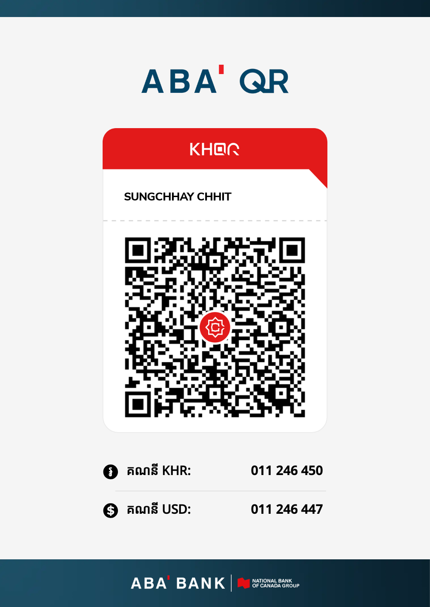

# Galaxy Download Manager (GDM)

**ភាសាខ្មែរ** · [English](#english)

GDM ជាកម្មវិធីគ្រប់គ្រងការទាញយកសម្រាប់ Windows ដែលឥតគិតថ្លៃសម្រាប់អ្នកទាំងអស់គ្នា (រួមទាំងក្រុមហ៊ុន សាលា និងស្ថាប័ន) ហើយគ្មានការផ្សាយពាណិជ្ជកម្ម គ្មាន telemetry គ្មាន account។ វាត្រូវបានបង្កើតដើម្បីជំនួស IDM និង NDM ដោយភាសាខ្មែរជាភាសាដំបូង។

> **v0.9 public beta** — សូមអាន [កំណត់ចេញផ្សាយ](docs/release/notes-0.9.0.md) មុនដំឡើង (មានដែនកំណត់ដែលដឹងរួច)។

## អ្វីដែល GDM ធ្វើ

- ទាញយកលឿនដោយការតភ្ជាប់ច្រើន (ចាប់ពី 2 ហើយបន្ថែមរហូតដល់ 8, អតិបរមា 32) និងបន្តពេលដាច់បណ្ដាញ ឬពេលបិទកុំព្យូទ័រ។
- **ឯកសារត្រឹមត្រូវជានិច្ច:** GDM មិនដែលដាក់ឈ្មោះចុងក្រោយលើឯកសារដែលខុសទេ (SHA-256, ការពិនិត្យ server ដែលកុហក, kill ×1000 គ្មានឯកសារខូច)។
- **សុវត្ថិភាពដោយមិនបាច់គិត:** Mark-of-the-Web + ការពិនិត្យ antivirus ពេលបញ្ចប់, គ្មាន port localhost, គ្មានការបើកឯកសារគ្រោះថ្នាក់ដោយស្វ័យប្រវត្តិ, update ចុះហត្ថលេខា។
- Extension សម្រាប់ Chrome, Edge (និង Brave, Vivaldi, Opera) និង Firefox: ចាប់ការទាញយក, <kbd>Ctrl</kbd> + ចុច = GDM, <kbd>Alt</kbd> + ចុច = browser, ម៉ឺនុយ "ទាញ link ទាំងអស់"។
- ផ្ទាំង Download Info ដូច IDM, ប្រភេទឯកសារ (category), ស្វែងរក (ខ្មែរ និងឡាតាំង), theme ភ្លឺ/ងងឹត, tray, កំណត់ល្បឿន។
- **ឧបករណ៍ចាប់ពីគេហទំព័រ** (កិច្ចការ ▾): រុករកគេហទំព័រ ហើយរាយរូបភាព វីដេអូ ឬឯកសារដែលអ្នកចង់បាន; អានតែប៉ុណ្ណោះ, ជៀស logout/delete, មានដែនកំណត់ការពារអន្ទាក់ ([docs/site-grabber.md](docs/site-grabber.md))។

## ដំឡើង

1. ទាញ `GDM-Setup_0.9.0_x64.exe` (Windows ARM: `_arm64`) ពី [GitHub Releases](https://github.com/goldeniq-official/Galaxy-Download-Manage-By-GoldenIQ-V1.0/releases) តែប៉ុណ្ណោះ។ ផ្ទៀងផ្ទាត់ SHA-256 ជាមួយ `SHA256SUMS.txt` និង `gh attestation verify GDM-Setup_0.9.0_x64.exe --repo goldeniq-official/Galaxy-Download-Manage-By-GoldenIQ-V1.0`។
2. Installer ដំឡើងសម្រាប់គណនីរបស់អ្នកប៉ុណ្ណោះ (គ្មាន admin)។ Beta នេះមិនទាន់មានហត្ថលេខា Authenticode ទេ ដូច្នេះ Windows SmartScreen អាចព្រមាន ("More info › Run anyway")។
3. ទំព័រចុងក្រោយនៃ Setup បង្ហាញ browser ដែលមាននៅលើកុំព្យូទ័រ៖ ចុច "បន្ថែម" ក្បែរ browser នីមួយៗ ហើយក្នុងហាងចុច "Add to Chrome" (Edge: "Get", Firefox: "Add to Firefox")។ GDM បង្ហាញ "បានភ្ជាប់" ពេលរួចរាល់ (ក៏មាននៅ ការកំណត់ › Browser ដែរ)។ ឯកសារ `GDM_…-setup.exe` គឺជា installer NSIS ដដែល (សម្រាប់ winget ឬការដំឡើងស្ងាត់ `/S`)។

## អាជ្ញាប័ណ្ណ

កូដប្រភពត្រូវបានផ្សព្វផ្សាយក្រោម **Reciprocal Public License 1.5** ([LICENSE](LICENSE), [NOTICE.md](NOTICE.md))។ នេះ**មិនមែន**ជា "open source យកទៅធ្វើអ្វីក៏បាន" ទេ: អ្នកណាកែ ហើយដាក់ប្រើ (Deploy) កំណែកែ ត្រូវបោះពុម្ពកូដរបស់ខ្លួន ប្ដូរឈ្មោះ និងរក្សាឈ្មោះអ្នកនិពន្ធ។ ឈ្មោះ "Galaxy Download Manager", "GDM" និង logo **មិន**ត្រូវបានផ្ដល់សិទ្ធិឱ្យ fork ប្រើទេ ([TRADEMARKS.md](TRADEMARKS.md))។ ការប្រើកម្មវិធីដើមគឺឥតគិតថ្លៃសម្រាប់គ្រប់គ្នា។

## គាំទ្រ GDM

GDM ឥតគិតថ្លៃសម្រាប់អ្នកទាំងអស់គ្នា រួមទាំងក្រុមហ៊ុន សាលា និងស្ថាប័នរដ្ឋ។ ការគាំទ្រជាការស្ម័គ្រចិត្ត៖ វាមិនបើកមុខងារណាមួយ មិនផ្ដល់អាទិភាពក្នុង support ឬការសម្រេចមុខងារ ហើយមិនមែនជាការទិញផលិតផល ឬសេវាទេ។ ស្កេន KHQR (ABA) ខាងក្រោមដោយកម្មវិធីធនាគាររបស់អ្នក (ក៏មាននៅក្នុងទំព័រ About របស់ app ដែរ)។ ស្ថាប័នដែលត្រូវការជំនួយដំឡើង ឬបង្ហាត់: [docs/services.md](docs/services.md)។ អ្នកឧបត្ថម្ភ: [docs/sponsors.md](docs/sponsors.md)។

ឯកសារផ្សេងៗ: [PRIVACY.md](PRIVACY.md) · [SECURITY.md](SECURITY.md) · [CONTRIBUTING.md](CONTRIBUTING.md) · [THIRD-PARTY-NOTICES.md](THIRD-PARTY-NOTICES.md)

Extension ពិតមានតែក្នុង store ដែលភ្ជាប់ពីក្នុង GDM ប៉ុណ្ណោះ (ID នឹងត្រូវបង្ហាញនៅទីនេះពេលបោះពុម្ព)។ Extension ផ្សេងដែលហៅខ្លួនថា "GDM" មិនមែនរបស់យើងទេ។

---

## English

GDM is a Windows download manager that is free for everyone (companies, schools and institutions included), with no ads, no telemetry and no account. It is built to replace IDM and NDM, Khmer first.

> **v0.9 public beta** — read the [release notes](docs/release/notes-0.9.0.md) first (known limitations listed).

**What it does:** multi-connection downloads (start at 2, grow to 8, up to 32) that resume after network loss or a restart; files are never published under their final name unless they are byte-correct (SHA-256, hostile-server checks, 1000 kill cycles with no corrupt file); Mark-of-the-Web and an antivirus check on completion, no localhost port, dangerous files never auto-open, signed updates; extensions for Chrome, Edge (also Brave, Vivaldi, Opera) and Firefox with <kbd>Ctrl</kbd>+click = GDM and <kbd>Alt</kbd>+click = browser; an IDM-style Download Info dialog, categories, search (Khmer and Latin), light/dark themes, tray, speed limits. A **site grabber** (Tasks ▾) explores a website and lists the images, videos or files you want; read-only, avoids logout/delete links, bounded against crawler traps ([docs/site-grabber.md](docs/site-grabber.md)).

**Install:** only from [GitHub Releases](https://github.com/goldeniq-official/Galaxy-Download-Manage-By-GoldenIQ-V1.0/releases); check `SHA256SUMS.txt` and `gh attestation verify`. Per-user, no admin. This beta has no Authenticode signature yet, so SmartScreen may warn.

**Licence:** the source is published under the **Reciprocal Public License 1.5** ([LICENSE](LICENSE), [NOTICE.md](NOTICE.md)). It is **not** "take it and do anything" open source: whoever modifies and deploys it must publish their changes, use a different name and keep the attribution. The names "Galaxy Download Manager", "GDM" and the logo are **not** licensed to forks ([TRADEMARKS.md](TRADEMARKS.md)). Using the original program is free for everyone.

**Support GDM:** GDM is free for everyone, including businesses, schools and government. Support is voluntary: it unlocks no feature, gives no priority in support or feature decisions, and buys no product or service. Scan the KHQR (ABA) in the Khmer section above with your banking app (it is also on the app's About page). Organisations that want help with deployment or training: [docs/services.md](docs/services.md). Sponsors: [docs/sponsors.md](docs/sponsors.md).

Galaxy Download Manager — Copyright (c) 2026 Golden IQ and Chhit Sungchhay. Licensed under the Reciprocal Public License 1.5. https://github.com/goldeniq-official/Galaxy-Download-Manage-By-GoldenIQ-V1.0
