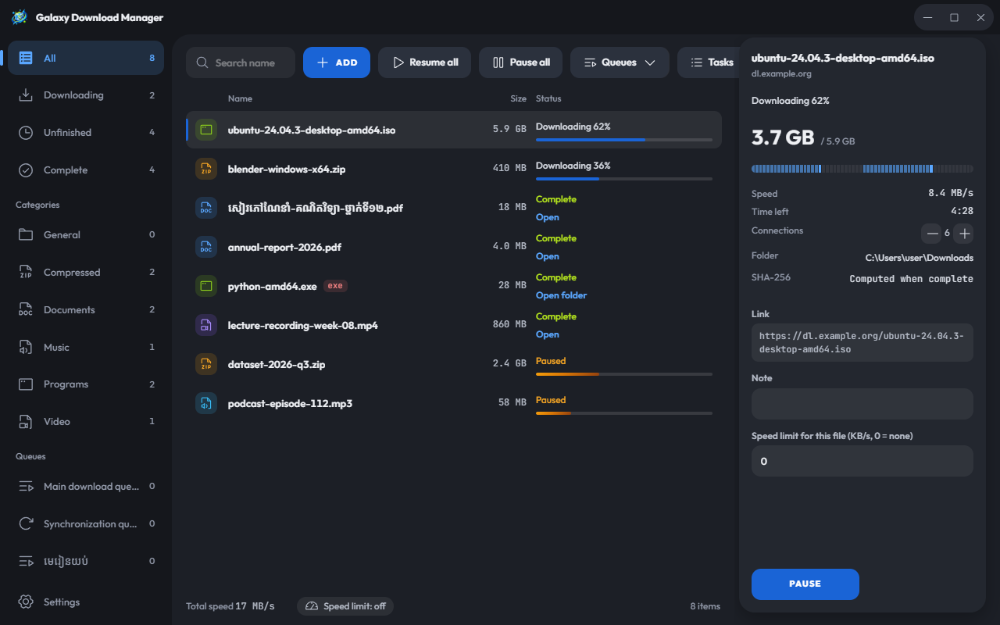
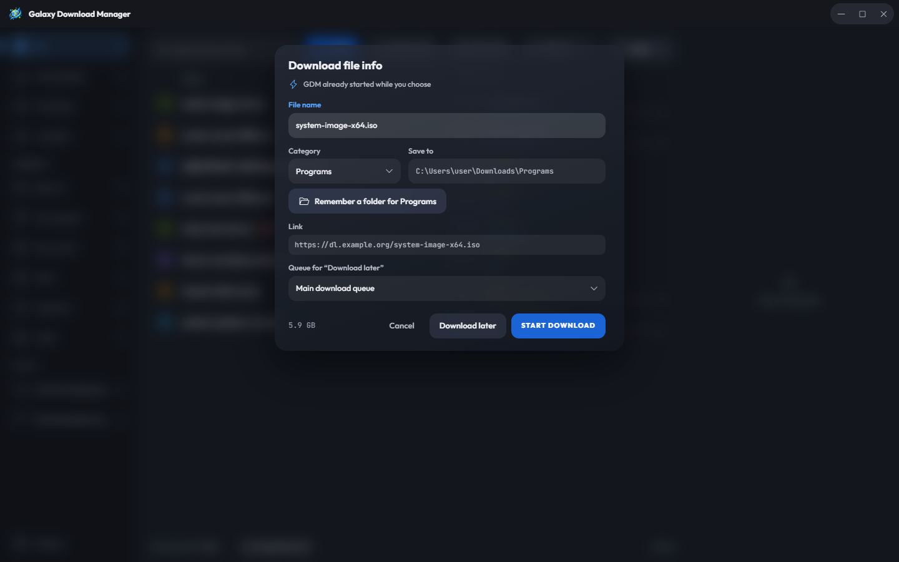
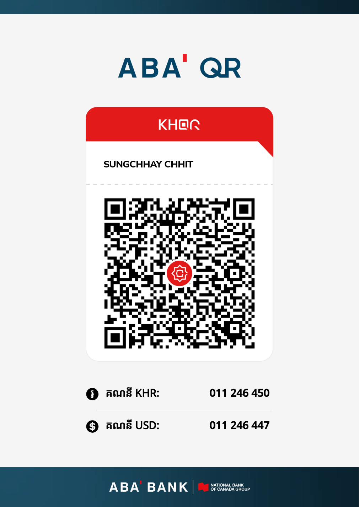

<div align="center">


# Galaxy Download Manager

**A download manager for Windows, macOS and Linux that resumes every transfer and checks every file before it is finished.**

[](https://github.com/goldeniq-official/Galaxy-Download-Manage-By-GoldenIQ-V1.0/releases)
[](#installation)
[](LICENSE)
[](#features)
[](PRIVACY.md)

[Website](https://gdm.goldeniq.app) · [Download](https://gdm.goldeniq.app/download) · [Release notes](docs/release/notes-1.0.0.md) · [Code signing policy](https://gdm.goldeniq.app/code-signing-policy) · [Privacy](PRIVACY.md)



</div>

## Overview

Galaxy Download Manager (GDM) is a desktop download manager for Windows, macOS and Linux. It downloads over multiple connections, resumes interrupted transfers, and gives a file its final name only after the download is complete and hashed with SHA-256 (on Windows, also after the system antivirus has scanned it). It is free for individuals and organisations alike, with no advertising, no telemetry and no account. The interface is available in Khmer and English.

Release 1.0.0 is produced for Windows (x64 and ARM64), macOS (Apple silicon and Intel) and Linux (x64 and ARM64). Windows 11 x64 is the tested platform; the other builds are previews until they have been tested on real machines. Known limitations are listed in the [release notes](docs/release/notes-1.0.0.md).

## Features

**Downloading**
- Multiple connections per file: 2 at start, up to 8 by default and up to 32, adjustable while a download is running.
- Resume after network loss or a system restart.
- Download queues with start and stop times, total and per-file speed limits, file categories, and search in Khmer and Latin script.

**Integrity and safety**
- Each file receives its final name only after the SHA-256 hash, and on Windows the antivirus scan, are complete. In Windows 11 x64 testing with 1,000 forced process terminations and deliberately faulty servers, no incomplete or incorrect file received its final name.
- When the server publishes a `.sha256` file, GDM compares the download against it. This check can be turned off.
- Every completed file is marked with its origin: Mark-of-the-Web on Windows, the quarantine attribute on macOS (checked by Gatekeeper), and origin attributes on Linux where the file system supports them; on macOS and Linux GDM removes the execute permission from every downloaded file. Potentially dangerous file types are never opened automatically.
- Downloads from addresses on the local network require confirmation. An invalid TLS certificate stops the download; there is no option to bypass it.
- Application updates are signed, checked once a day, installed only while GDM is idle, and can be turned off.

**Browser integration**
- Extensions for Google Chrome, Microsoft Edge and Firefox communicate with GDM through native messaging.
- <kbd>Ctrl</kbd>+click sends a link to GDM; <kbd>Alt</kbd>+click leaves it to the browser.
- Context menu entries "Download with GDM" and "Download all links with GDM", and an option to stop capturing downloads on a specific site.
- By default, each captured download opens the Download File Info dialog for the file name, category and destination. The transfer starts while the dialog is open.

<div align="center">

</div>

**Site grabber**
- Explores a website from a start page and lists the images, videos or documents that match your selection, for you to choose from. It sends read-only requests, never submits forms, never opens logout or delete links, and stops at fixed limits on pages, requests and time. See [docs/site-grabber.md](docs/site-grabber.md).

Screenshots show the application with example data.

## Installation

### Windows

1. Download `GDM-Setup_1.0.0_windows-x64.exe` (or `GDM-Setup_1.0.0_windows-arm64.exe` for ARM64) from the [GitHub Releases page](https://github.com/goldeniq-official/Galaxy-Download-Manage-By-GoldenIQ-V1.0/releases) or from https://gdm.goldeniq.app/download.
2. Verify the file before running it. Its SHA-256 hash must match the entry in `SHA256SUMS.txt` from the same release, and its build provenance can be confirmed with the GitHub CLI:
   ```
   gh attestation verify GDM-Setup_1.0.0_windows-x64.exe --repo goldeniq-official/Galaxy-Download-Manage-By-GoldenIQ-V1.0
   ```
3. Run the installer. It installs for the current user and does not require administrator rights. Release 1.0.0 does not yet carry an Authenticode signature, so Windows SmartScreen may show a warning. After the verification in step 2 succeeds, select **More info › Run anyway**.
4. On the final page of Setup, select **Add** next to each detected browser and follow the instructions shown. Until the extension is published in the Chrome Web Store and Edge Add-ons, Chromium-based browsers load it from the folder installed with GDM, with Developer mode turned on. The same option is available later under **Settings › Browsers**.

Each release also contains `GDM_1.0.0_windows-x64-setup.exe`, the underlying installer used by the updater and for silent installation (`/S`). The included uninstaller removes the browser registration and the autostart entry.

### macOS

Download `GDM_1.0.0_macos-arm64.dmg` (Apple silicon) or `GDM_1.0.0_macos-x64.dmg` (Intel), verify it with `SHA256SUMS.txt` and `gh attestation verify` as above, and drag GDM to **Applications** (browser integration requires it there). The build is not notarized yet: open it the first time once, then select **System Settings › Privacy & Security › Open Anyway**.

### Linux

Download the `.deb`, `.rpm` or `.AppImage` for `linux-x64` or `linux-arm64` and verify it as above. Install the `.deb` or `.rpm` for browser integration; the AppImage runs without installing (`chmod +x`, then run it) but cannot register the browser extension.

## Official sources

Official builds are published only on the [GitHub Releases page](https://github.com/goldeniq-official/Galaxy-Download-Manage-By-GoldenIQ-V1.0/releases) of this repository and on https://gdm.goldeniq.app. Browser extensions are official only when installed from GDM itself or from a store listing linked from GDM. Any other build, extension or listing is not an official release.

## Code signing policy

Release builds are produced from this repository by GitHub Actions and published with SHA-256 checksums and build provenance attestations. The full code signing policy, including team roles, is published at https://gdm.goldeniq.app/code-signing-policy.

## Privacy

GDM collects no usage data and has no account system. Apart from the downloads you start, it makes network requests only for the update check, `.sha256` verification files, synchronisation queues you configure, and optional video components after you agree to install them. Each of these is described in [PRIVACY.md](PRIVACY.md), together with how to turn it off.

## Licence and intellectual property

Galaxy Download Manager is copyright © 2026 Golden IQ and Chhit Sungchhay (the Licensor). The source code is published under the **Reciprocal Public License 1.5** (SPDX: `RPL-1.5`), an OSI-approved open source licence. The licence text is in [LICENSE](LICENSE); its application to this project is set out in [NOTICE.md](NOTICE.md). The Licensor offers GDM under no other licence. This summary is for convenience only; [LICENSE](LICENSE) is the binding text.

**Use.** Anyone may download, install and use the official release free of charge, including businesses, schools and public institutions.

**Modification.** Any person or organisation that modifies GDM and Deploys the result must meet the following obligations. Under RPL-1.5, Deploy includes internal use within a business or organisation, not only public distribution (§1.2). The only exceptions are Research and Personal Use.
- The complete source code of the modified version, including any components required to install and run it, must be published under RPL-1.5 within one month of Deployment and remain available for at least twelve months after Deployment ends (§1.12, §6.1). No fee may be charged for that source beyond the actual cost of copying and distribution.
- The modified version must carry a distinct title (§6.0). It may not be named "Galaxy Download Manager" or "GDM".
- Every modification must be documented, the modified version must state that it is derived from Galaxy Download Manager, and the names of the Licensor must appear in its source code and in its user-visible copyright notices (§6.2, §6.4(d)).
- Existing copyright notices, change notices and licence text may not be modified or removed without the Licensor's written permission (§6.2).
- Everyone who creates or contributes to a modified version grants the Licensor a worldwide, royalty-free licence to use and distribute those changes (§6.0).

**Trademarks.** The licence grants no rights to the Licensor's trademarks (§5.0). The names "Galaxy Download Manager", "GDM" (for download software) and "Golden IQ", and the Galaxy Download Manager logo, may not be used for any modified version, website, store listing or product, or in any way that suggests official status or endorsement, without the Licensor's written permission. Truthful statements such as "based on Galaxy Download Manager" remain permitted. See [TRADEMARKS.md](TRADEMARKS.md).

**Enforcement.** Any use that does not comply with RPL-1.5 or the trademark policy is not licensed. Failure to enforce a provision in one case does not waive the right to enforce it in another (§13.4). To report a suspected infringement or to request trademark permission, open an issue titled "Trademark request" in this repository.

**Third-party components** remain under their own licences, listed in [THIRD-PARTY-NOTICES.md](THIRD-PARTY-NOTICES.md). Optional tools that GDM downloads at the user's request, such as yt-dlp and FFmpeg, are separate programs under their own licences and are not included in the installer.

## Supporting the project

GDM is free for everyone. Financial support is voluntary: it unlocks no feature, grants no priority in support or development decisions, and is not the purchase of a product or service. Support can be sent by scanning the KHQR code below with a banking app that supports KHQR. The same code is shown on the application's About page.



Organisations that require deployment assistance or training: [docs/services.md](docs/services.md). Sponsorship terms: [docs/sponsors.md](docs/sponsors.md).

## Contributing and security

- Contributions are accepted under RPL-1.5. See [CONTRIBUTING.md](CONTRIBUTING.md).
- Security vulnerabilities must be reported privately as described in [SECURITY.md](SECURITY.md), never in a public issue.

---

Galaxy Download Manager — Copyright (c) 2026 Golden IQ and Chhit Sungchhay. Licensed under the Reciprocal Public License 1.5. https://github.com/goldeniq-official/Galaxy-Download-Manage-By-GoldenIQ-V1.0
